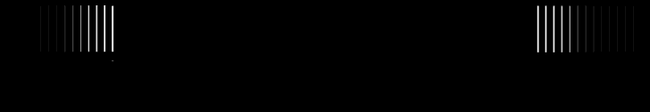

<p align="center">
  
  <br>
  
</p>

<p align="center">
  <a href="#la-question-de-départ">Démarche</a> ·
  <a href="#comment-fonctionne-lapproche">Algorithme</a> ·
  <a href="#état-davancement">Avancement</a> ·
  <a href="#lancer-la-démonstration">Installation</a>
</p>

**Que peut-on apprendre d'un film en observant uniquement son affiche ?**

Nostradamovies est un projet étudiant porté sous le nom **Lethal Data**, autour de
l'analyse statistique des affiches de cinéma. L'objectif est de transformer des
caractéristiques visuelles — couleurs, visages, texte et composition — en données,
puis d'étudier leur lien avec les genres cinématographiques.

Le dépôt réunit les notebooks d'exploration, les premiers essais de classification
et une interface web de démonstration. Il documente une démarche expérimentale,
avec ses hypothèses et ses limites.

> **Statut : prototype pédagogique.** Le client Vue et l'API Flask peuvent être
> lancés localement. Les genres et indicateurs affichés par l'application sont
> encore des valeurs de démonstration ; le modèle statistique n'est pas intégré
> au parcours d'envoi d'image.

<p align="center">
  
</p>

## La question de départ

Une affiche constitue déjà un langage visuel : palette sombre ou lumineuse,
présence de personnages, place du titre, quantité de texte… Le projet cherche à
mesurer ces éléments pour explorer leur pouvoir descriptif et prédictif.

La démarche consiste à :

1. Constituer un corpus d'affiches associées aux métadonnées des films.
2. Extraire des indicateurs mesurables depuis les images.
3. Explorer leur distribution et leurs relations avec les genres.
4. Expérimenter plusieurs classifieurs sur ces indicateurs.
5. Restituer les observations dans une démonstration web.

Un même film pouvant appartenir à plusieurs genres, la prédiction est abordée
comme un problème de **classification multi-label**.

## Données et indicateurs

Le fichier [`data/test.csv`](data/test.csv) contient **1 000 films** avec leurs
métadonnées et une première série d'indicateurs extraits. Malgré son nom, ce
fichier est utilisé comme source pour l'entraînement et la séparation train/test
dans le notebook ; il ne constitue pas un jeu de test indépendant.

| Famille | Indicateurs explorés dans les notebooks |
| :--- | :--- |
| Couleur | Intensité moyenne des canaux, couleur dominante, diversité des couleurs, teintes chaudes et froides |
| Visages | Présence, nombre, position centrale et proportion de l'image occupée |
| Texte | Présence de texte par zone, nombre de lignes, surface et position des blocs détectés |
| Composition | Rapport largeur/hauteur et répartition spatiale de certains éléments |

Les métadonnées incluent notamment le titre, l'année et les genres. Pour prédire
à partir d'une affiche seule, les données utilisées par le modèle doivent aussi
pouvoir être calculées sur une image inconnue.

Les jeux d'images complets référencés dans les notebooks ne sont pas inclus dans
le dépôt. Les **31 affiches** présentes dans le client permettent d'alimenter la
galerie locale ; elles ne reconstituent pas le corpus d'entraînement.

## Comment fonctionne l'approche

```text
Affiche du film
      │
      ▼
Extraction d'indicateurs visuels
Couleurs · visages · texte · composition
      │
      ▼
Table de caractéristiques + genres connus
      │
      ▼
Séparation entraînement / test
      │
      ▼
Classification multi-label
Random Forest · KNN · SVM
      │
      ▼
Genres prédits et évaluation
```

L'extraction s'appuie notamment sur **OpenCV**, **NumPy**, **dlib** pour les visages
et **pytesseract** pour la reconnaissance de texte. Les notebooks utilisent aussi
un clustering **K-means** des pixels pour estimer une couleur dominante.

Le notebook [`nostradaprediction.ipynb`](data/nostradaprediction.ipynb) prévoit :

- une séparation des données en **80 % d'entraînement et 20 % de test** ;
- un encodage des genres avec `MultiLabelBinarizer` ;
- trois classifieurs enveloppés dans `OneVsRestClassifier` : **Random Forest**,
  **K plus proches voisins (KNN)** et **SVM** ;
- une évaluation par **score de Jaccard**, qui mesure le recouvrement entre genres
  réels et prédits, et **Hamming loss**, qui mesure les erreurs d'étiquetage ;
- l'export des modèles, de l'encodeur et des prédictions pour une future intégration.

Le code expérimental force une sélection des trois meilleurs scores lorsqu'il
ne prédit aucun genre ou en prédit plus de trois. Ce choix reste à valider : il
ne représente pas une mesure de confiance.

**Aucune performance validée n'est revendiquée dans ce dépôt.** Les exports de
modèles et les rapports d'évaluation ne sont pas fournis ; le notebook nécessite
encore des corrections avant de pouvoir être reproduit de bout en bout.

## État d'avancement

| Élément | État actuel |
| :--- | :--- |
| Corpus tabulaire | CSV de 1 000 films disponible ; corpus d'images complet absent |
| Extraction d'indicateurs | Fonctions et premiers exports présents dans les notebooks ; consolidation nécessaire |
| Expériences de classification | Code Random Forest, KNN et SVM présent ; résultats à reproduire et à valider |
| Modèle utilisable par l'API | Aucun modèle entraîné fourni ou chargé par l'application |
| Démonstration web | Envoi d'image, galerie et vérification de santé disponibles localement |
| Résultats de l'API | Genres, titre et autres indicateurs encore écrits en dur |
| Vérification du client | Compilation Vite vérifiée ; erreurs TypeScript préexistantes à corriger |

### Limites identifiées

- Les colonnes attendues par le notebook de classification ne correspondent pas
  toutes à celles du CSV fourni, et la fonction d'extraction appelée pour prédire
  sur une nouvelle image reste à implémenter.
- Les libellés de genres doivent être normalisés avant leur encodage.
- Certains indicateurs nécessitent une correction : la surface du plus grand
  bloc de texte vaut notamment 100 % pour toutes les lignes du CSV actuel.
- Les conventions de couleur et le prétraitement doivent être harmonisés entre
  l'entraînement et l'analyse d'une nouvelle affiche.
- Un corpus de films issus d'un classement IMDb ne représente pas nécessairement
  la diversité des affiches soumises par les utilisateurs.

### Prochaines étapes

- [ ] Reconstituer et documenter le corpus d'images et ses conditions d'utilisation.
- [ ] Unifier l'extraction des indicateurs dans un code réutilisable et testé.
- [ ] Nettoyer les genres, corriger les indicateurs et séparer les données par film.
- [ ] Reproduire les expériences et comparer les résultats à une référence naïve.
- [ ] Exporter un modèle avec son prétraitement et son encodeur de genres.
- [ ] Brancher la prédiction réelle sur l'API et afficher l'incertitude dans le client.
- [ ] Fiabiliser les fichiers reçus, les erreurs, les types et le déploiement.

## Explorer le dépôt

```text
client/                         Interface Vue 3, TypeScript et Tailwind CSS
server/                         API Flask utilisée par le client
  api/service/image_service.py  Réponses de démonstration et lecture des affiches
data/
  nostradamovies.ipynb          Extraction d'indicateurs sur le corpus
  nostradaprediction.ipynb      Expériences de classification multi-label
  classifier.ipynb              Chargement exploratoire du jeu de données
  test.csv                     Métadonnées et premiers indicateurs extraits
app/                            Ancien prototype Flask / Tailwind incomplet
docs/assets/                    Visuels du README exportés des ressources du site
```

L'extraction sur une image isolée est également explorée dans
[`server/api/service/image_processing.ipynb`](server/api/service/image_processing.ipynb).

## Lancer la démonstration

Prérequis : **Python 3** avec `venv`, **Node.js** et **npm**. La remise en route locale
a été vérifiée avec Python 3.9 ; le README initial ciblait Python 3.11.
Le fichier de verrouillage du client nécessite **pnpm 8**.

### 1. API Flask

Depuis la racine du dépôt :

```sh
python3 -m venv .venv
.venv/bin/python -m pip install -r server/requirements-api.txt
```

Pour utiliser les affiches du client dans la galerie, créer ce lien **uniquement
si `server/static/data/poster` n'existe pas déjà** (macOS / Linux) :

```sh
mkdir -p server/static/data
ln -s ../../../client/src/assets/dtf server/static/data/poster
```

Puis lancer l'API :

```sh
.venv/bin/python -m flask --app server.app run --host 127.0.0.1 --port 5001
```

### 2. Client Vue

Dans un second terminal :

```sh
cd client
npx --yes pnpm@8.15.9 install --frozen-lockfile
npm run dev -- --host 127.0.0.1 --port 5173
```

- **Accueil et envoi d'image** : http://127.0.0.1:5173
- **Galerie** : http://127.0.0.1:5173/dataframe
- **État de l'API** : http://127.0.0.1:5173/health

Le client attend l'API sur `http://localhost:5001`. L'envoi d'image renvoie l'image
et des résultats de démonstration, sans exécuter les notebooks ni un modèle IA.

<details>
<summary><strong>Notebooks et dépendances scientifiques</strong></summary>

Les dépendances de `data/requirements.txt` et `server/requirements-data.txt`
correspondent à l'environnement scientifique historique. Elles ne sont pas
nécessaires au lancement de la démonstration web.

La reproduction des notebooks demande de restaurer leurs jeux de données,
d'adapter leurs chemins locaux et de résoudre les incohérences décrites plus
haut. L'OCR nécessite aussi le moteur Tesseract installé sur la machine ; le
paquet Python `pytesseract` constitue son interface.

</details>

---

<p align="center">
  <strong>Lethal Data / Nostradamovies</strong><br>
  <sub>Un projet étudiant pour apprendre à passer de l'image aux données, puis des données aux hypothèses.</sub>
</p>
